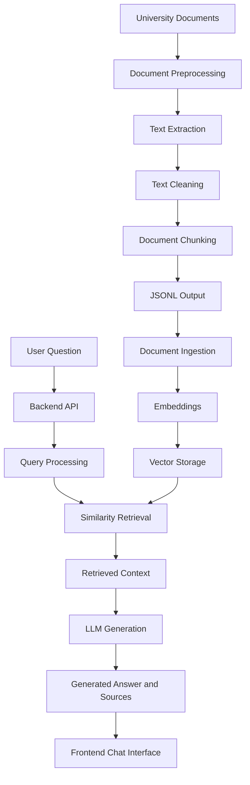

# RAG-USTHB — Retrieval-Augmented Generation System

A document-based AI assistant designed to retrieve relevant information from university documents and generate context-aware answers using Retrieval-Augmented Generation (RAG).

## Overview

**RAG-USTHB** is an academic document assistant that allows users to ask questions about university-related documents and receive answers based on retrieved content.

Instead of relying only on the language model's general knowledge, the system processes documents, extracts their content, divides it into smaller chunks, and retrieves relevant information to provide context for answer generation.

The main objective is to make academic and institutional information easier to access, search, and understand.

## Key Features

- **Document preprocessing:** Extract and prepare content from supported document formats.
- **Text cleaning:** Organize extracted content before indexing.
- **Document chunking:** Split documents into smaller segments for retrieval.
- **Semantic retrieval:** Retrieve relevant document content for a user's question.
- **Context-aware generation:** Generate responses using retrieved context.
- **Source references:** Display available document references alongside responses.
- **Interactive interface:** Provide a chat-based experience for asking questions.
- **Multilingual text support:** Handle Arabic, French, and English text presentation.

> Note: The exact supported formats, embedding provider, vector storage implementation, and language model should be documented according to the current configuration of the project.

## System Architecture

The system follows a Retrieval-Augmented Generation workflow.

## How It Works

### 1. Document Preprocessing

The preprocessing stage prepares source documents for the RAG pipeline.

Its main operations include:

- Reading documents.
- Extracting textual content.
- Cleaning extracted text.
- Dividing content into chunks.
- Preparing structured output in JSONL format.

### 2. Document Ingestion

The ingestion stage takes the prepared chunks and processes them for retrieval.

It includes:

- Loading processed document data.
- Generating vector embeddings.
- Storing the representations in the configured vector storage system.

### 3. Retrieval

When a user submits a question:

1. The question is received by the backend.
2. The query is processed.
3. Relevant document chunks are retrieved using similarity search.
4. The retrieved content is prepared as context.

### 4. Answer Generation

The retrieved context is provided to the language model to generate an answer.

The objective is to produce responses grounded in the available documents rather than relying exclusively on general model knowledge.

### 5. Frontend Presentation

The frontend displays the conversation and generated answers.

It supports formatted Markdown content, including headings, lists, tables, and code blocks. The interface also includes text-direction handling for Arabic and mixed-language content.

##
