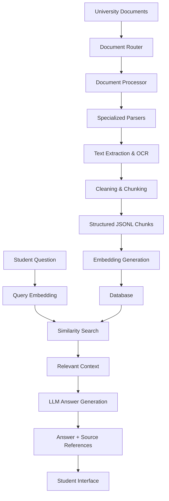

# SAHLA — The USTHB Answer Engine

  <strong>An AI-powered university assistant that makes academic information easier to find.</strong>

  <a href="https://rag-usthb-flrj.vercel.app">Live Demo</a> ·
  <a href="https://github.com/sofiakhorf/RAG-USTHB">GitHub Repository</a>

---

## Overview

**SAHLA** is a Retrieval-Augmented Generation (RAG) chatbot designed to help students at the University of Science and Technology Houari Boumediene (USTHB) access academic and administrative information more easily.

Students can ask questions in natural language and receive relevant, clear answers based on university documents, accompanied by references to the original sources.

The project focuses on making scattered university information searchable through a simple, student-friendly interface.

## The Problem

University information is often distributed across different platforms and document formats, including:

- Official university websites and announcements.
- PDF documents and academic regulations.
- Excel files and study programs.
- Scanned documents in Arabic and French.
- Different academic and administrative publications.

As a result, students may need to browse multiple pages and documents just to find one specific piece of information.

This process can be time-consuming, frustrating, and sometimes unsuccessful.

## Our Solution

SAHLA provides a centralized, AI-powered question-answering experience.

Instead of manually searching through multiple documents, students can simply ask a question and receive an answer generated from relevant university information.

Our system combines:

- **Automated Document Processing:** Extracting and organizing information from different document formats.
- **Multilingual OCR:** Handling scanned documents in Arabic and French.
- **Intelligent Chunking:** Dividing documents into structured, searchable text segments while preserving their metadata and source information.
- **Semantic Search:** Finding relevant information based on the meaning of a student's question.
- **Retrieval-Augmented Generation (RAG):** Using retrieved document content to generate answers grounded in available sources.

## Key Features

- Natural-language question answering.
- Retrieval of relevant university information.
- Source-based answers with document references.
- Support for multiple document formats.
- Arabic and French OCR for scanned documents.
- Multilingual semantic embeddings.
- A simple and accessible student-facing interface.

## System Architecture

SAHLA follows a modular RAG architecture, separating document ingestion, embedding generation, information retrieval, and answer generation.

### 1. Document Ingestion Pipeline

The ingestion pipeline prepares university documents for retrieval.

It includes:

- A Router to identify document families.
- A Processor to coordinate document processing.
- Ten family-specific parsers.
- A batch runner for processing multiple documents.
- Text extraction, OCR, cleaning, and chunk generation.

The pipeline produces structured JSONL chunks containing extracted content and associated metadata.

### 2. Embedding Generation

Each text chunk is transformed into a numerical vector using the multilingual Sentence Transformers model:

`sentence-transformers/paraphrase-multilingual-MiniLM-L12-v2`

The model generates 384-dimensional embeddings, allowing the system to represent text semantically and compare its meaning with student questions.

Embedding generation is handled through a dedicated Hugging Face Space.

### 3. Database & Retrieval

The processed chunks, metadata, and embeddings are stored in the database.

When a student submits a question:

1. The question is converted into an embedding.
2. The system compares it with stored chunk embeddings.
3. Cosine similarity is used to rank relevant chunks.
4. The most relevant information is selected as context.

### 4. Answer Generation

The retrieved context is passed to the configured LLM API.

The language model uses this context to generate a clear response grounded in the available university documents.

The final response includes relevant source references to help students identify the original information.

## Technology Stack

| Category | Technologies |
|---|---|
| Programming Languages | Python, TypeScript, SQL |
| Frontend | React, Vite, Tailwind CSS |
| Backend | Django, Django REST Framework, Pydantic |
| Database | PostgreSQL, Supabase |
| Document Processing | PyMuPDF, pdfplumber, python-docx, openpyxl |
| OCR & Image Processing | Tesseract OCR, Pillow, LibreOffice |
| Embeddings | Sentence Transformers |
| Retrieval | Cosine Similarity Search |
| Answer Generation | LLM API, OpenRouter |
| AI Model | `cohere/north-mini-code:free` (configured model ID) |
| Hosting | Vercel, Render, Hugging Face Spaces |
| Development & Version Control | Git, GitHub, Scrapy |

Additional development support tools include v0 for frontend scaffolding, AI coding assistance, and an AI-assisted chunk-audit workflow.

## Current Deployment

- **Frontend:** [SAHLA Web Application](https://rag-usthb-flrj.vercel.app)

## Current Scope & Limitations

The current MVP focuses on USTHB students, particularly students who need academic and administrative information.

Current limitations include:

- The knowledge base is focused on USTHB.
- Answer quality depends on the availability and quality of source documents.
- Local dialect understanding requires further improvement.
- Document management and user-role capabilities remain limited.
- Hosting resources may affect response times and scalability.

## Future Development

Our vision is to evolve SAHLA into a more scalable and flexible university information platform.

Planned improvements include:

1. **Multi-University Support:** Expanding the platform to support multiple universities, with separate knowledge bases and data isolation.
2. **Multiple User Roles:** Introducing dedicated experiences and permissions for students, professors, and administrative staff.
3. **Personal Document Upload:** Allowing students to upload their own PDFs and ask questions about their content.
4. **Enhanced Multilingual Support:** Improving Arabic, French, English, and local dialect understanding.
5. **Advanced AI Assistance:** Adding document summarization, lesson explanations, and other academic support features.
6. **Performance & Scalability:** Improving retrieval efficiency, infrastructure, and system performance as the platform grows.

## Team

**Built by students, for students.**

| Team Member | Contribution |
|---|---|
| **Sofia Khorf** | Document ingestion pipeline, routing, specialized parsers, bilingual OCR, and chunk quality auditing. |
| **Salsabil Hamdane** | Embeddings, database integration, similarity-based retrieval, and Django REST backend. |
| **Mohamed Amine** | Frontend development and student-facing user experience. |

## Project Links

- **Live Application:** https://rag-usthb-flrj.vercel.app
- **GitHub Repository:** https://github.com/sofiakhorf/RAG-USTHB
- **Backend API:** https://rag-usthb-1.onrender.com
- **Hugging Face Embedding Service:** https://huggingface.co/spaces/salsabilhm/rag-usthb-embeddings

---

  <strong>SAHLA — Making University Information Accessible, One Question at a Time.</strong>

  Developed as part of the <strong>Thirduni Cohort 1 — Build with AI Program (2026)</strong>.

